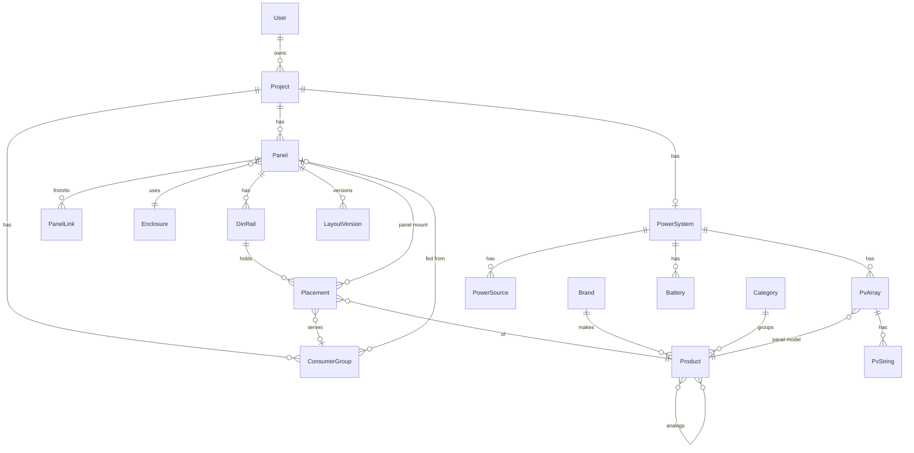

# План: Electricity Planner

Источник требований: [`PROMPT.md`](../PROMPT.md). Дисклеймер: расчёты ориентировочные и не заменяют проект сертифицированного специалиста.

## 1. Допущения

| # | Допущение |
|---|-----------|
| A1 | Авторизация: сессии Django + CSRF (SPA и API за одним nginx, один origin). Регистрация/логин через django-allauth (headless-эндпоинты не нужны: используем JSON-обёртки над allauth). |
| A2 | Нормы: ДБН В.2.5-23, ПУЭ, IEC 60898/61008/61009/61439, IEC 60364-7-712. Таблицы допустимых токов — Cu, изоляция ПВХ, 2 или 3 нагруженных жилы, способ прокладки «в стене/трубе» (опорный B1/A1), t = 30 °C. |
| A3 | Цены в каталоге — ориентировочные UAH с НДС, поле `price_checked=false` и дата; правятся в admin или импортом CSV. |
| A4 | Seed: ~150 позиций. Артикулы реальные, где уверенно известны; прочие помечены `needs_verification=true`. |
| A5 | PV-выработка: упрощённая модель (kWp × удельная выработка по региону × поправки ориентации/угла). PVGIS — опционально, позже, с кешем. |
| A6 | Один редактор на проект (без совместного редактирования); мобильный — только просмотр. |
| A7 | Деплой: docker-compose; в образах 12-factor, `/healthz`, `/readyz`; helm/манифесты вне объёма. |
| A8 | Напряжения: 230 В (1ф) и 400 В (3ф), 50 Гц. Системы заземления: TN-C-S, TN-S, TT. |
| A9 | Перекос фаз: `(Pmax − Pср) / Pср > 15%` — подсветка. |
| A10 | CI: GitHub Actions, образы собираются без публикации. |

## 2. Структура репозитория

```
.
├── PROMPT.md
├── README.md
├── docs/PLAN.md
├── .pre-commit-config.yaml  .editorconfig  .gitignore
├── .github/workflows/ci.yml
├── docker-compose.yml  deploy/nginx/default.conf
├── backend/
│   ├── pyproject.toml            # ruff, mypy strict, pytest
│   ├── manage.py
│   ├── config/                   # settings (django-environ), urls, wsgi
│   ├── accounts/                 # пользователи, allauth
│   ├── catalog/                  # Brand, Category, Product, CSV, seed
│   ├── projects/                 # Project, Panel, PanelLink, ConsumerGroup
│   ├── panels/                   # Enclosure, DinRail, Placement, LayoutVersion
│   ├── power/                    # Source, Scenario, PvArray, Battery
│   │   └── services/             # чистая логика (без Django)
│   ├── calculations/             # чистая логика (без Django)
│   └── exports/                  # BOM, PDF (WeasyPrint), XLSX (openpyxl)
└── frontend/
    ├── package.json  vite.config.ts  tailwind.config.ts
    └── src/
        ├── api/                  # типы из OpenAPI (openapi-typescript)
        ├── features/{board,single-line,catalog,groups,power,pv,bom,auth}/
        ├── shared/               # UI, i18n (ru/uk), хуки
        └── store/                # Zustand (+ undo/redo)
```

Правило слоёв: `calculations/` и `power/services/` — dataclass-входы/выходы, без импортов Django; Django-слой только мапит модели в dataclass.

## 3. ER-модель



Ключевые поля:
- **Project**: owner, name, object_type (flat/house), grid (1ph/3ph), main_breaker_a, earthing (TN-C-S/TN-S/TT), price_tier (eco/mid/premium), tmin_c (−20).
- **Panel**: project, name, kind (main/floor/backup/dc), enclosure, ip, mounting (flush/surface), parent via PanelLink.
- **ConsumerGroup**: project, name, room, type, power_w, cos_phi, phase (L1/L2/L3/3ph), length_m, backed_up, + рассчитанные (breaker_a, curve, cable_mm2, rcd_ma, dU_pct).
- **Product**: brand, category, sku, type, rated_a, poles, curve, leakage_ma, rcd_type (AC/A), modules, w/h/d_mm, electrical (JSON), price, price_date, tier, needs_verification.
- **DinRail**: panel, row_index, modules_capacity (N×M). **Placement**: panel, rail (nullable → монтажная панель), product, group, start_module, width_modules, x/y_mm (для панели), label.
- **LayoutVersion**: panel, number, snapshot JSON, created_at.
- **PowerSource**: kind (grid/generator/inverter), phases, kva/kw, cos_phi, autostart, bypass, parallel_count. **Battery**: chemistry (LiFePO4/AGM), voltage_v, kwh, dod, max_discharge_kw. **PvArray**: panel product, count, tilt, azimuth. **PvString**: array, mppt_index, modules_in_series, strings_parallel.

## 4. API (DRF, `/api/v1/`, OpenAPI на `/api/schema/`)

| Ресурс | Методы |
|---|---|
| `auth/` register, login, logout, me | POST/GET |
| `projects/`, `projects/{id}/` | CRUD (только владелец) |
| `projects/{id}/panels/`, `panels/{id}/` | CRUD, `POST panels/{id}/autolayout/`, `GET panels/{id}/validate/` |
| `panels/{id}/placements/` | CRUD + bulk PATCH (автосохранение), серверная проверка ширины/коллизий/совместимости |
| `panels/{id}/versions/` | list, create, `POST …/{n}/restore/` |
| `projects/{id}/groups/` | CRUD, `POST …/autoselect/` (автоподбор) |
| `projects/{id}/calc/` | GET: нагрузка, Кс, баланс фаз, селективность, предупреждения |
| `projects/{id}/power/` | CRUD источников, сценария, АКБ; `GET …/check/` |
| `projects/{id}/pv/` | CRUD массивов/строк; `GET …/check/` (Voc, Vmp, Isc, DC/AC), `GET …/yield/` |
| `catalog/{brands,categories,products}/` | list+filter (тип, бренд, номинал, полюса); `GET products/{id}/analogs/?tier=`; `import/`, `export/` CSV (admin) |
| `projects/{id}/bom/` | GET JSON; `bom.pdf`, `bom.xlsx`; `panels/{id}/export.{svg,png}`; `labels.pdf` |
| `/healthz`, `/readyz` | liveness / readiness |

Ошибки валидации: `422`-подобный формат DRF `{field: [msgs]}`; для компоновки — `{code, placement_id, message}`.

## 5. Формулы и таблицы

**Ток.** 1ф: `Ib = P / (U·cosφ)`, U = 230 В. 3ф: `Ib = P / (√3·U·cosφ)`, U = 400 В.

**Автомат.** Ряд In: 6, 10, 16, 20, 25, 32, 40, 50, 63, 80, 100, 125 А. Условия: `Ib ≤ In ≤ Iz`, `1.45·In ≤ 1.45·Iz` (I2 по IEC 60898). Характеристика: B — освещение, розетки; C — двигатели/нагрев с пуском (кондиционер, бойлер, стиралка, плита ≥ 25 А → C); D — только по явному выбору.

**Допустимый ток Cu, Iz (А), ПВХ, в стене/трубе, 30 °C:**

| S, мм² | 1.5 | 2.5 | 4 | 6 | 10 | 16 | 25 | 35 |
|---|---|---|---|---|---|---|---|---|
| 2 нагр. жилы | 19 | 27 | 36 | 46 | 63 | 85 | 112 | 138 |
| 3 нагр. жилы | 17 | 25 | 33 | 42 | 57 | 76 | 99 | 121 |

Поправка на температуру/группировку — коэффициент k (по умолчанию 1.0, задаётся в проекте). Минимум по типу: освещение 1.5, розетки 2.5, плита/бойлер ≥ 2.5/4 по току.

**Падение напряжения.** 1ф: `ΔU% = 2·ρ·L·I·cosφ / (S·230) · 100`. 3ф: `ΔU% = √3·ρ·L·I·cosφ / (S·400) · 100`. ρ(Cu) = 0.0225 Ом·мм²/м (при рабочей t ≈ 70 °C). Лимит: освещение 3%, прочие 5% (настраивается). Сечение увеличивается ступенями, пока `Iz ≥ In` и `ΔU ≤ лимит`.

**УЗО / дифавтомат.** 30 мА, тип A (AC допускается для освещения): розетки, ванная, кухня, улица, бойлер, стиралка, посудомойка, тёплый пол. Группировка: ≤ 4–6 групп на УЗО; номинал УЗО ≥ суммы токов с учётом Кс и ≥ In старшего автомата выше по цепи; пожарное УЗО 100–300 мА (S-тип 300 мА) на вводе, селективность по времени. Плита/кондиционер — дифавтомат 30 мА.

**Коэффициенты спроса Кс:**

| Тип | Кс |
|---|---|
| Освещение | 0.8 |
| Розетки (общие) | 0.5 |
| Кухня (розетки) | 0.7 |
| Плита | 0.7 |
| Бойлер | 1.0 |
| Кондиционер | 0.8 |
| Тёплый пол | 0.8 |
| Стиралка/посудомойка | 0.7 |
| Прочее | 0.6 |

Итог: `P_расч = Σ(P_i·Кс_i)·Ко`, Ко = 0.9 при > 5 групп (настраивается). Проверка ввода: `In_ввод ≥ I_расч`.

**Балансировка фаз (3ф).** Жадное распределение однофазных групп по фазам (по убыванию `P·Кс`) в наименее нагруженную; метрика перекоса по A9.

**Селективность по номиналам.** `In_верхний ≥ 1.6·In_нижний` (для автоматов того же типа); для УЗО: верхний S-тип/ с задержкой и `IΔn_верх ≥ 3·IΔn_ниж`.

**Корпус.** `модулей = Σ ширин·(1 + 0.2)`, округление до ряда корпусов (рядов N × модулей M: 12, 18, 24, 36, 48, 72…), минимум рядов по габаритам; 1 модуль = 17.5 мм.

**Резерв.** Нагрузка резервируемых групп `P_bk = Σ(P_i·Кс_i)`. Генератор: `S_gen ≥ P_bk / 0.8` и `≥ P_пуск` (пуск двигателя = 3–6× номинала для кондиционера/насоса, берётся максимальный + остальные по Кс). 3ф генератор: перекос по A9. Инвертор: `P_inv ≥ P_bk`, пик ≥ пусковой. Автономия: `t = E_kWh·DoD·η / P_load` (η = 0.9; DoD LiFePO4 0.9, AGM 0.5). Правила валидации: запрет параллели генератор↔сеть без блокировки; 4П АВР для 3ф (коммутация N) в TN-S/TN-C-S, в TT — по схеме; УЗО после инвертора с учётом связи N-PE (если инвертор создаёт N-PE на выходе в автономе).

**PV (IEC 60364-7-712):**
- `Voc_max = N_s·Voc·(1 + β_Voc·(Tmin − 25))` ≤ Vmax MPPT (β < 0, поэтому Voc растёт на морозе);
- `Vmp_min = N_s·Vmp·(1 + β_Vmp·(Tcell_max − 25))` ≥ Vmin MPPT, Tcell_max = 70 °C; `Vmp_nom` в диапазоне MPPT;
- `Isc_total = Isc·N_parallel·1.25 ≤ Imax входа` (Isc по спецификации, параметр 1.25);
- DC/AC: `kWp / P_inv_AC > 1.3` → подсветка;
- gPV предохранитель при строк > 2: `1.5·Isc ≤ In_fuse ≤ 2.4·Isc` и ≤ Imax обратного тока модуля; DC-УЗИП: `Ucpv ≥ 1.2·Voc_max`;
- PV-кабель: 4 или 6 мм², `Iz ≥ 1.25·Isc`, `ΔU ≤ 1–2%`;
- выработка: `E = kWp · Y · k_ориент · k_угол`, Y = 1100 кВт·ч/кВт·год (юг Украины 1200, север 1000; задаётся), k_ориент из таблицы azimuth/tilt.

## 6. Этапы и тикеты

0 — план/каркас (#2) → 1 — модели, каталог, seed (#3) → 2 — расчёты (#4) → 3 — API (#5) → 4 — редактор щита (#6) → 5 — однолинейная схема (#7) → 6 — АВР/генератор/инвертор (#8) → 7 — PV (#9) → 8 — BOM/экспорт (#10) → 9 — Docker/CI (#11). После каждого этапа — миграции, тесты, отчёт, ожидание подтверждения.
